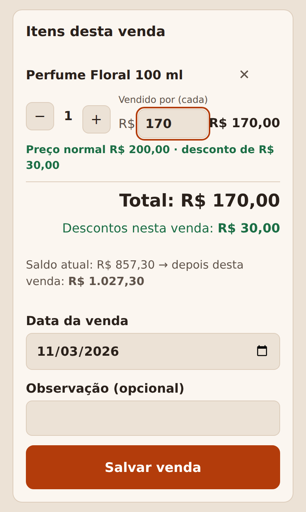
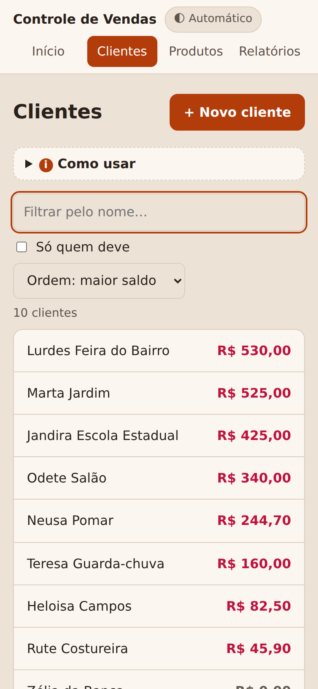
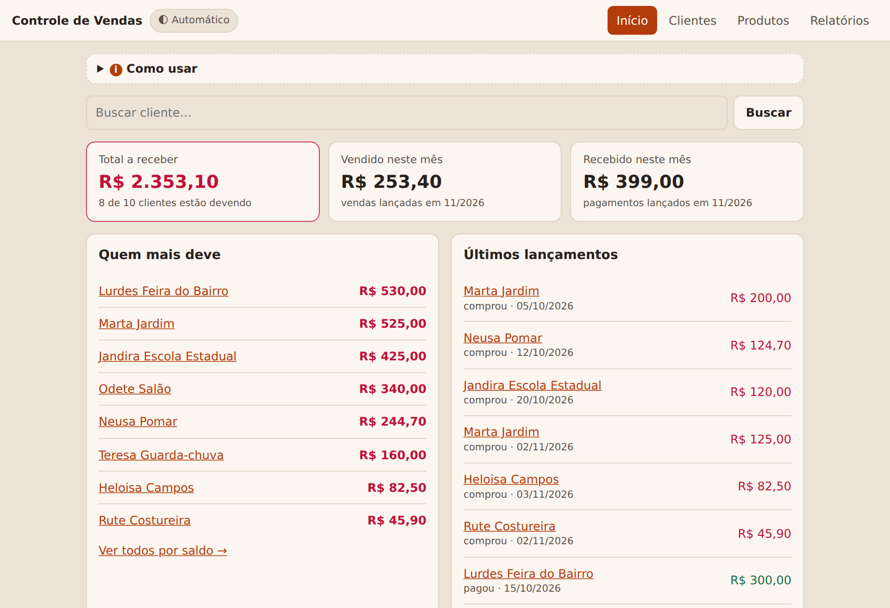
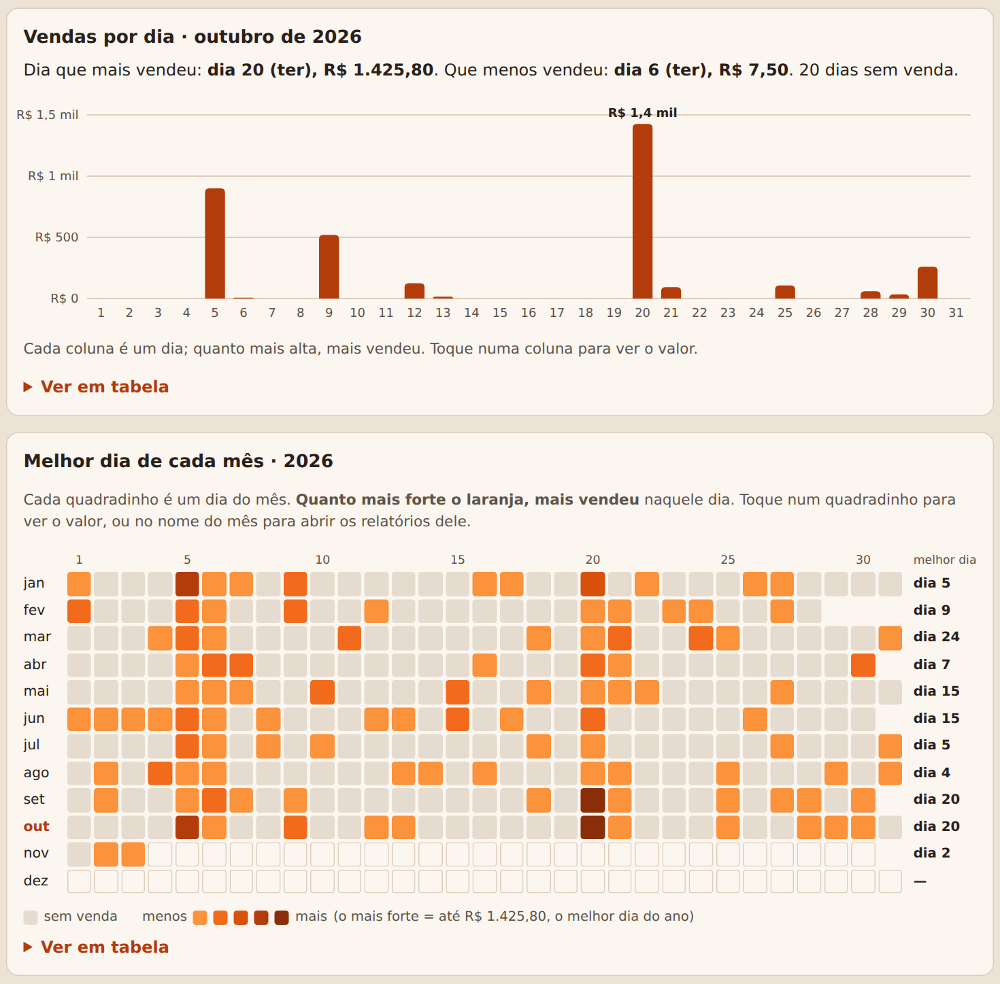
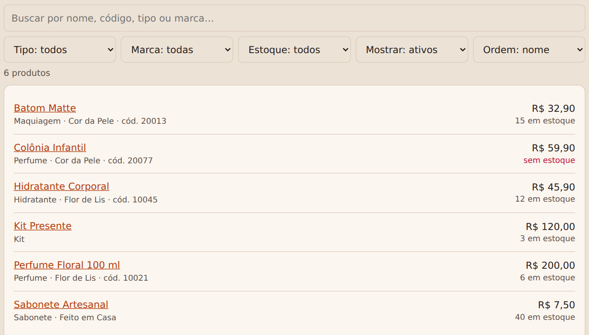
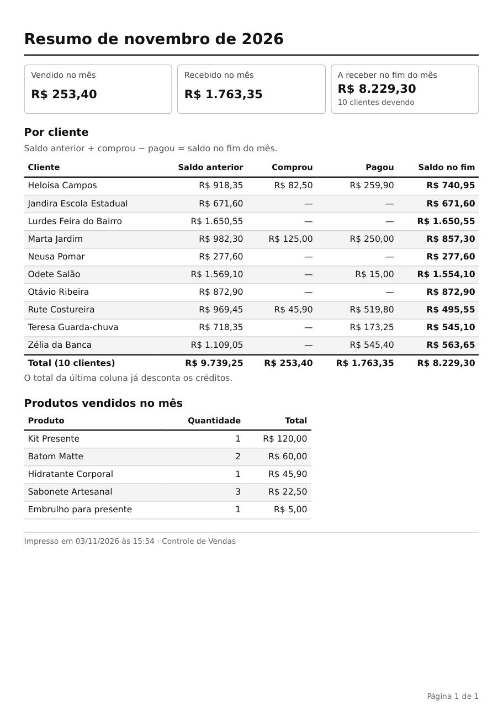

# Controle de Vendas Fiado

Um site simples para quem vende a prazo ("fiado") e se perde na planilha: cadastro de clientes e
produtos, venda lançada direto na tela do cliente, pagamentos, e o saldo de cada um calculado
sozinho — com telas grandes, explicadas e pensadas para quem tem dificuldade com tecnologia.

Fiz para a minha mãe, que vende para centenas de clientes e controlava tudo numa planilha com uma
aba por mês. Mas o problema é o de muita gente que vende assim.

<p align="center">
  
  
  
</p>

## O problema

A planilha antiga copiava o saldo de cada cliente de um mês para o outro **procurando pelo nome**.
Se o nome mudava uma letra ("Marta Jardim" virava "Marta jardim"), a dívida simplesmente sumia, sem
nenhum aviso. Medindo aba por aba, encontrei milhares de reais em saldos que tinham saído da conta
sem pagamento registrado. Além disso: nenhum registro do que foi vendido, fórmulas quebrando a cada
mês novo, e muito trabalho manual.

## O que o sistema faz

- **Clientes** com busca que ignora acento e maiúscula, e que não deixa cadastrar o mesmo nome duas vezes.
  Cliente desativado some da lista (há um filtro para ver só os desativados), mas a dívida dele continua contando.
- **Quem está há muito tempo sem pagar**: lista de quem deve e não paga há mais de 30/60/90/180 dias, com o
  telefone para ligar — usando também o histórico de pagamentos da planilha antiga, mês a mês desde 2023.
- **Produtos** com preço, estoque e, opcionalmente, **tipo, marca e código** — busca por qualquer um deles e
  filtros por tipo, marca, estoque e situação. A venda desconta do estoque, cancelar devolve.
- **Nova venda** na tela do cliente: toca nos produtos, ajusta a quantidade, dá **desconto** no item
  ("o perfume é 200, saiu por 170") e vê o saldo depois da venda antes de salvar.
- **Pagamentos** com o botão "pagou tudo"; quem paga a mais fica com crédito.
- **Histórico** de cada cliente com o saldo depois de cada lançamento. Lançamento errado é cancelado
  (fica riscado), nunca apagado.
- **Relatórios do mês** e **folhas para imprimir** (ou salvar em PDF e mandar pelo WhatsApp): resumo
  geral com saldo anterior → comprou → pagou → saldo no fim, e extrato de cada cliente.
- **Gráficos**: vendas por dia do mês (colunas) e o **melhor dia de cada mês** no ano (mapa de calor dia × mês),
  para ver de relance "em outubro, o dia que mais vendeu foi o 20".
- **Relatório por produto**: quanto vendeu mês a mês, quem mais comprou, descontos e últimas vendas.
- **Exportação para Excel** e backup do banco num clique.
- **Importação** dos clientes e saldos da planilha antiga, conferindo se a soma bate.
- Toda tela tem um quadro **"Como usar"** explicando o que fazer.
- **Tema claro e escuro**: segue o aparelho, com um botão no topo para escolher.

<p align="center">
  
</p>
<p align="center">
  
</p>
<p align="center">
  
</p>
<p align="center">
  
</p>

## Decisões que importam

- **O saldo nunca é guardado nem copiado**: é sempre calculado como
  `saldo inicial + compras − pagamentos`. É isso que elimina o problema da dívida que some.
- **Dinheiro em centavos (inteiro)**, nunca `float`. `"1.234,56"` e `"12,5"` viram centavos num só lugar.
- **O preço vai junto com a venda** (e o preço normal também): mudar o preço do produto depois não
  altera vendas antigas, e o desconto dado fica registrado.
- **Falhar alto**: o importador recusa planilha com fórmula sem valor calculado em vez de importar
  zero calado; o extrato confere se o saldo fecha antes de mostrar.
- **Celular primeiro**: botões grandes, nada mais largo que a tela (há teste para isso).
- **Gráficos com cor conferida**: a escala do mapa de calor foi validada (um só tom, degraus visíveis, contraste
  com o fundo) no tema claro e no escuro; todo gráfico tem um resumo em texto e uma tabela com os mesmos números.

## Testes

128 testes: regras de saldo, dinheiro, estoque, desconto, importação, impressão, gráficos, filtros — e testes num
navegador de verdade (Chromium via Playwright) que clicam pelas telas em tamanho de celular,
conferem que não há erro de JavaScript e que nenhuma tela passa da largura do celular.
As cores têm contraste conferido (4,5:1 ou mais) nos dois temas.
Esses testes pegaram bugs reais, como um toque em "Salvar venda" que não salvava quando o
preço tinha acabado de ser editado.

```bash
python -m pytest -q                    # tudo (os de navegador são pulados se o Playwright não estiver instalado)
python -m pytest -q tests/test_sistema.py
```

## Rodar com dados de demonstração

Python 3.11+.

```bash
python -m venv .venv && source .venv/bin/activate
pip install -r requirements.txt
cp .env.exemplo .env                   # e defina APP_SENHA e APP_CHAVE
python demo.py                         # cria demo.db com clientes e produtos fictícios
APP_BANCO=demo.db python app.py        # abra http://localhost:5000
```

Para os testes de navegador: `pip install playwright && python -m playwright install chromium`.

## Arquivos

| arquivo | o que faz |
|---|---|
| `app.py` | site (Flask): rotas e login |
| `db.py` | banco SQLite, regras de saldo, estoque, desconto e relatórios |
| `exportar.py` | planilha Excel com tudo |
| `graficos.py` | números dos gráficos (vendas por dia e mapa do ano) |
| `importar_planilha.py` | importa clientes e saldo de uma aba da planilha antiga |
| `importar_ultimos_pagamentos.py` | lê na planilha antiga o último mês em que cada cliente pagou |
| `relatorio_saldos_sumidos.py` | lista saldos que sumiram de um mês para o outro na planilha antiga |
| `wsgi.py` | entrada do site na hospedagem (confere a configuração antes de subir) |
| `demo.py` | banco de demonstração com um ano de vendas fictícias |
| `templates/`, `static/` | telas (HTML, CSS e um pouco de JavaScript, sem framework) |
| `tests/` | `test_sistema.py` (regras e site) e `test_navegador.py` (cliques no navegador) |

## Na internet

Pronto para o PythonAnywhere (passo a passo em [`PUBLICAR.md`](PUBLICAR.md)): `wsgi.py` só sobe com senha
forte e banco existente, login com bloqueio depois de 5 erros, proteção CSRF em todo formulário, cookie só
por HTTPS, cabeçalhos de segurança, fuso de São Paulo (servidores rodam em UTC), cópia automática diária
do banco e aviso quando ninguém baixa uma cópia há mais de 7 dias.

## Próximos passos

- Desconto no total da venda, além do desconto por item.

Todos os nomes e valores nas imagens e no `demo.py` são fictícios.
